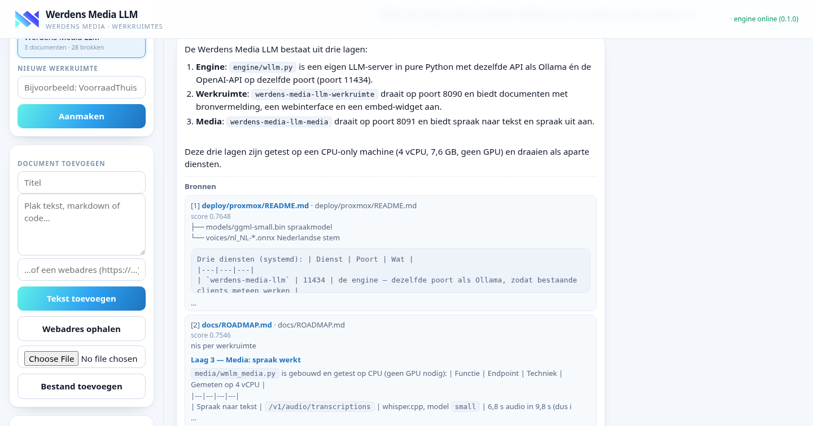
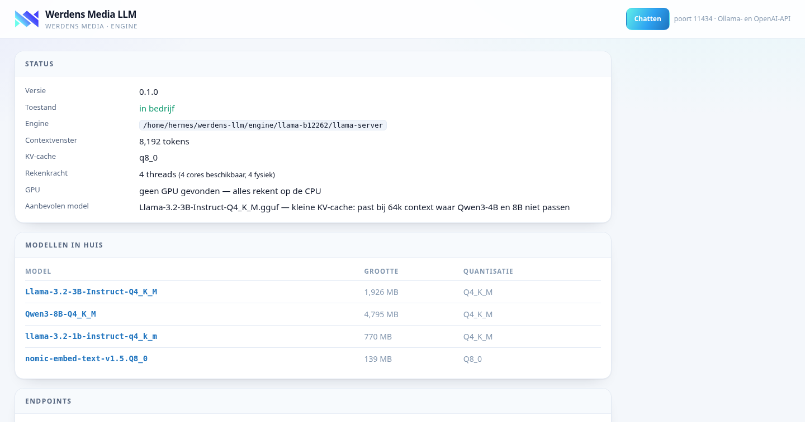
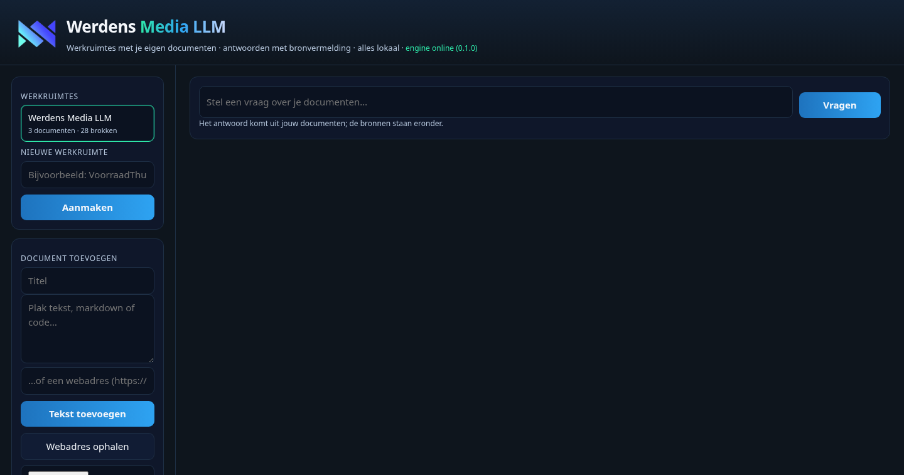
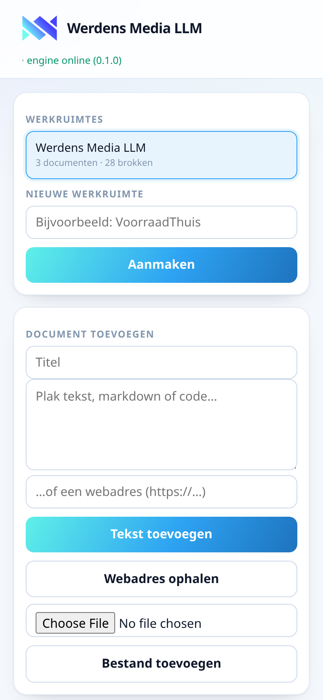
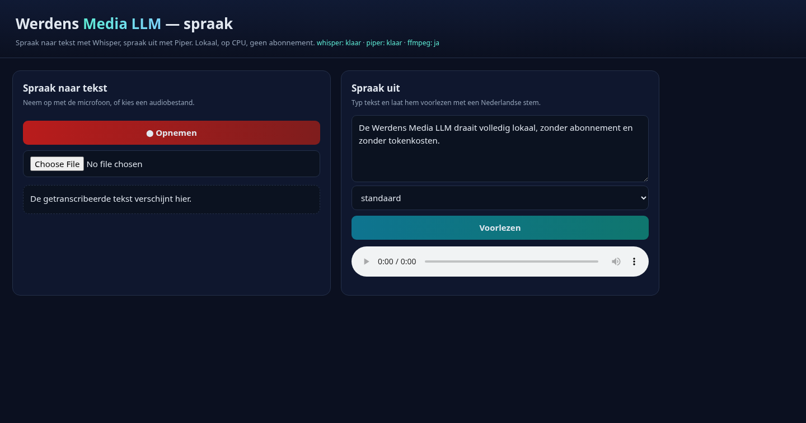
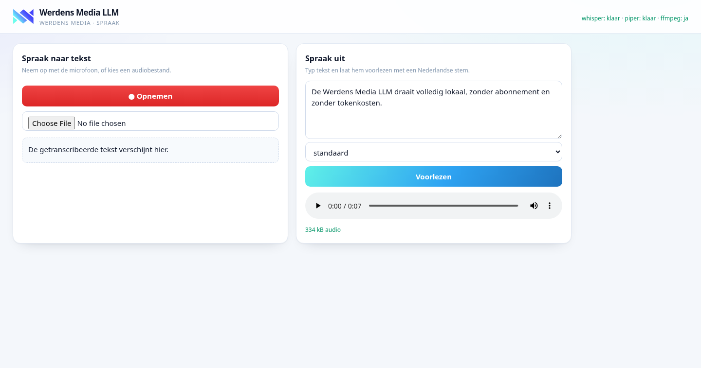
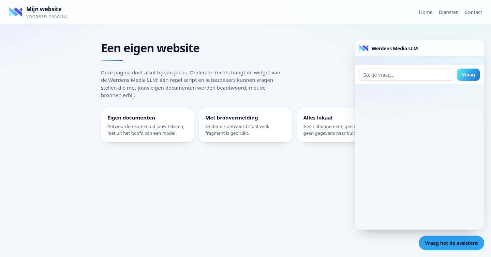
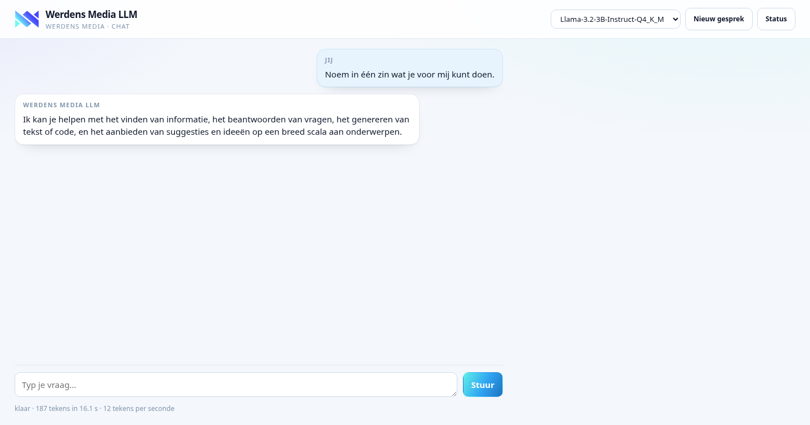
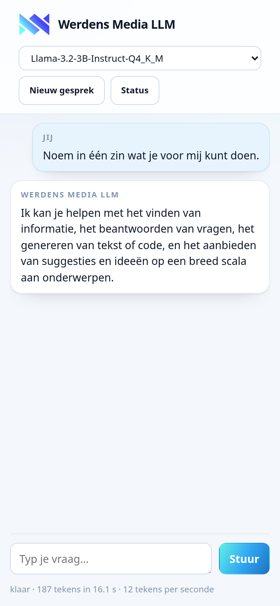

# Werdens Media LLM

Eigen LLM-stack voor Werdens Media: één engine met dezelfde API als Ollama én de
OpenAI-API, werkruimtes met je eigen documenten en bronvermelding, en spraak naar
tekst en spraak uit. Alles op je eigen hardware, zonder abonnement en zonder
tokenkosten — met een Nederlandse interface in de huisstijl van Werdens Media.



[](#installeren-op-proxmox)
[](https://www.python.org/)
[](https://github.com/ggml-org/llama.cpp)
[](#api)
[](README.md#licentie)

---

## Wat het is

Eén stack, drie lagen, alles op je eigen hardware:

| Laag | Wat het doet | Status |
|---|---|---|
| **1. Engine** | Eigen LLM-server met dezelfde API als Ollama plus de OpenAI-API. Beheert modellen, start en stopt de rekenkracht-engine, houdt modellen warm. | **werkt en is getest** |
| **2. Werkruimte** | Werkruimtes per project, documenten erin met bronvermelding, vectordatabase op SQLite, gesprekken, API-sleutels, embed-widget voor je eigen sites. | **werkt en is getest** |
| **3. Media** | Spraak naar tekst (Whisper), spraak uit (Piper, Nederlandse stemmen). Beeld (ComfyUI/SDXL) en video staan nog open. | **spraak werkt** |

Waarom eigen code in plaats van een bestaande app forken: één techniek in plaats
van twee, geen licentie die meereist, en alles wat erin zit is van jou.

## Zo ziet het eruit

Alle drie de lagen hebben een eigen webpagina. Hieronder echte opnamen van de
draaiende stack — op een CPU zonder GPU, met 4 vCPU en 7,6 GB geheugen.
De pagina's staan in de huisstijl van **Werdens Monitor**: licht, kaarten op wit,
blauw `#2ea3f2` als accent en de merk-gradient (cyaan → blauw) op de knoppen, met
het logo linksboven naast de naam.

**De engine** (poort 11434) — status, modellen in huis en de endpoints:



**De werkruimte** (poort 8090) — een vraag stellen over je eigen documenten:



En het antwoord, met de bronnen eronder en de score per bron:


Op een telefoon klapt hetzelfde scherm naar één kolom:



**De medialaag** (poort 8091) — spraak naar tekst en spraak uit met een
Nederlandse stem:



En hier is echt iets voorgelezen: 7,5 seconden spraak in 0,92 seconden — acht keer
sneller dan realtime, op de CPU.



**De embed-widget** — één regel script op je eigen site, met antwoorden uit jouw
documenten en de bronnen erbij. Een werkende voorbeeldpagina staat in
`docs/embed-voorbeeld.html`.



**Een rondleiding in beeld** (echte opname, inclusief de wachttijd op een
antwoord — op een CPU duurt dat ongeveer anderhalve minuut):

[](docs/demo.mp4)

De opnamen zijn gemaakt met `scripts/screenshots.js` en `scripts/record-demo.js`,
zodat je ze na een wijziging zelf opnieuw kunt maken.

## Chatten met de AI

Open `http://<server>:11434/chat` in je browser — of klik op **Chatten** op de
statuspagina. Typ je vraag, druk op Enter, en het antwoord komt woord voor woord
binnen. Alles blijft op je eigen machine.



- Je kiest zelf het model in de kop, als er meer dan één in huis staat.
- **Nieuw gesprek** begint opnieuw; het gesprek blijft staan als je de pagina
  herlaadt of de volgende dag terugkomt.
- **Stop** breekt een lang antwoord af — de engine stopt dan ook echt met rekenen
  in plaats van door te werken voor een leeg scherm.
- Onderaan staat wat het kostte: tekens, seconden en tekens per seconde.
- Op een telefoon werkt dezelfde pagina:



## Snel starten (op een Debian-machine)

```bash
# 1) engine ophalen (llama.cpp, voorgebouwde binary — geen compiler nodig)
mkdir -p engine && cd engine
curl -sLO https://github.com/ggml-org/llama.cpp/releases/download/b12262/llama-b12262-bin-ubuntu-x64.tar.gz
tar xzf llama-b12262-bin-ubuntu-x64.tar.gz

# 2) server starten
cd .. && python3 engine/wllm.py serve      # luistert op :11434
```

## Installeren op Windows

Download de map van deze repo (groene **Code**-knop → *Download ZIP*), pak hem uit
en dubbelklik op **`deploy\windows\start-werdens-media-llm.bat`**.

De eerste keer wordt alles wat nodig is opgehaald (llama.cpp voor Windows plus de
modellen, circa 2,5 GB); daarna starten de drie lagen meteen en opent de
chatpagina. Nodig is alleen **Python 3** van [python.org](https://www.python.org/downloads/windows/)
(met het vinkje *Add python.exe to PATH*); verder niets te installeren.

```powershell
# liever zelf de variant kiezen (cpu, vulkan, cuda12, cuda13)
python deploy\windows\setup.py --variant vulkan
```

Stoppen: `deploy\windows\stop-werdens-media-llm.bat`. Zie
[`deploy/windows/README.md`](deploy/windows/README.md) voor de details, de
poorten en spraak.

## Installeren op Proxmox

Eén regel, in de shell van je **Proxmox-host** (als root):

```bash
bash -c "$(curl -fsSL https://raw.githubusercontent.com/Theberas04/werdens-media-llm/main/deploy/proxmox/install.sh)"
```

Dat haalt de kit op naar `/opt/werdens-media-llm-kit` en zet de hele stack in één
unprivileged LXC (Debian 13, 4 cores, 12 GB, 60 GB schijf). Reken op een kwartier
tot een half uur: Debian ophalen, llama.cpp bouwen en de modellen downloaden.

Liever eerst kijken wat er gebeurt, of meer rekenkracht meegeven:

```bash
# niets aanmaken, alleen de kit ophalen en vertellen wat er zou gebeuren
DROOG=1 bash -c "$(curl -fsSL https://raw.githubusercontent.com/Theberas04/werdens-media-llm/main/deploy/proxmox/install.sh)"

# 6 cores, 16 GB en een vast adres
CORES=6 MEMORY=16384 DISK=80 STATIC_IP=192.168.1.100/24 GATEWAY=192.168.1.1 \
  bash -c "$(curl -fsSL https://raw.githubusercontent.com/Theberas04/werdens-media-llm/main/deploy/proxmox/install.sh)"
```

Zelf de bestanden in handen houden kan ook: `git clone` de repo en draai
`bash deploy/proxmox/create-werdens-media-llm-lxc.sh`. Of stap voor stap, in een
bestaande container:

```bash
bash deploy/proxmox/provision-werdens-media-llm.sh <CTID>
bash deploy/proxmox/check-werdens-media-llm.sh <CTID>
```

**Start de container niet** en zie je alleen `Failed to spawn container`? Die regel
zegt niet waaróm. Draai dan dit op de host; het haalt de echte oorzaak op en zegt
wat je moet doen:

```bash
CTID=105 bash -c "$(curl -fsSL https://raw.githubusercontent.com/Theberas04/werdens-media-llm/main/deploy/proxmox/diagnose-werdens-media-llm.sh)"
```

Instellingen gaan via env-variabelen vóór het commando: `CORES`, `MEMORY`, `DISK`,
`STATIC_IP`, `GATEWAY`, `CT_HOSTNAME`. Het inrichtscript kiest het chatmodel zelf
met de gemeten cijfers; wil je een eigen keuze, zet dan `WMLM_MODEL_REPO` en
`WMLM_MODEL_FILE`, of `SKIP_MODELS=1` om het downloaden over te slaan.

## API

De server praat twee talen op dezelfde poort, zodat bestaande software zonder
aanpassing werkt.

**Ollama-vorm** — `/api/version`, `/api/tags`, `/api/ps`, `/api/show`,
`/api/pull`, `/api/chat`, `/api/generate`, `/api/embed`

**OpenAI-vorm** — `/v1/models`, `/v1/chat/completions`, `/v1/completions`,
`/v1/embeddings`

Daarbovenop twee eigen lagen, elk op hun eigen poort:

**Werkruimtelaag (8090)** — documenten in een werkruimte met bronvermelding:

- `GET|POST /api/workspaces`, `GET /api/workspaces/<slug>/documents`
- `POST /api/workspaces/<slug>/documents` (plak tekst) en `.../documents/bestand` (haal een webpagina op)
- `POST /api/workspaces/<slug>/query` — antwoord met bronnen
- `POST /v1/chat/completions` met `model="werkruimte:<slug>"` — dezelfde vraag in OpenAI-vorm
- `POST /api/workspaces/<slug>/sleutels` — API-sleutel voor je eigen apps

**Medialaag (8091)** — spraak, en beeld zodra ComfyUI is aangesloten:

- `POST /v1/audio/transcriptions` — spraakbericht naar tekst (multipart of rauw bestand)
- `POST /v1/audio/speech` — tekst naar spraak, Nederlandse stem
- `GET /v1/voices`, `GET /health`
- `POST /v1/images/generations` — beeld (vraagt `WMLM_COMFY_URL`)
- `GET /` — webpagina met microfoonopname en voorleesknop

```bash
# chat, Ollama-vorm met streaming
curl http://192.168.1.100:11434/api/chat -d '{
  "model": "Llama-3.2-3B-Instruct-Q4_K_M",
  "messages": [{"role": "user", "content": "Noem drie Nederlandse provincies."}],
  "stream": true
}'

# chat, OpenAI-vorm
curl http://192.168.1.100:11434/v1/chat/completions -d '{
  "model": "Llama-3.2-3B-Instruct-Q4_K_M",
  "messages": [{"role": "user", "content": "Hallo"}]
}'

# spraak uit, en datzelfde spraakbericht weer terug naar tekst
curl -s http://192.168.1.100:8091/v1/audio/speech \
  -d '{"input":"Dit is de Werdens Media LLM."}' -o hallo.wav
curl -s http://192.168.1.100:8091/v1/audio/transcriptions \
  -F file=@hallo.wav | jq -r .text
```

## CLI

```bash
python3 engine/wllm.py serve        # server starten
python3 engine/wllm.py list         # modellen met grootte, quantisatie en digest
python3 engine/wllm.py ps           # wat er nu geladen is
python3 engine/wllm.py aanbevelen            # welk model past op deze machine?
python3 engine/wllm.py aanbevelen --meten    # dezelfde vraag, met echte cijfers
python3 engine/wllm.py model-info <model>    # architectuur en geheugengebruik
python3 engine/wllm.py pull hf:unsloth/Llama-3.2-3B-Instruct-GGUF/Llama-3.2-3B-Instruct-Q4_K_M.gguf
python3 engine/wllm.py run Llama-3.2-3B-Instruct-Q4_K_M "Wat is een LLM?"
```

## Koppelen

**Hermes Agent** (per sessie, zonder je configuratie te veranderen):

```bash
hermes chat -q "vraag" -m Llama-3.2-3B-Instruct-Q4_K_M \
  --provider custom --base-url http://192.168.1.100:11434/v1 --api-key wmlm-local
```

Twee dingen om te weten voordat je dit doet:
- Hermes eist een contextvenster van **minimaal 64.000 tokens**. Zit je daaronder,
  dan weigert hij met een duidelijke melding — dat is geen storing.
- Op een CPU zonder GPU is dit **traag**: een prompt van 14.000 tokens duurt al
  snel tien minuten. Bruikbaar voor losse vragen en documentvragen, niet als
  agent-brein. Met een GPU (12 GB of meer) verandert dat volledig.

**Je eigen apps**: alles wat OpenAI of Ollama praat, kan tegen deze server. Geen
API-sleutel nodig en er verlaat niets je eigen netwerk.

## Welk model past op jouw machine?

Dit is de knop voor kwaliteit: hoe groter het model, hoe beter het antwoord. Maar
grootte is niet gratis — bij 64k context (wat Hermes eist) kost de KV-cache
alleen al ettelijke gigabytes.

De server meet het zelf, uit de architectuur in de GGUF-kop:

```bash
python3 engine/wllm.py aanbevelen --meten
```

Dat haalt per model ongeveer 1 MB op (de kop, niet het hele bestand) en rekent
uit wat er past. Gemeten voorbeeld op een CPU zonder GPU met 8 GB en 64k context:

| Model | Gewichten | KV-cache | Nodig | Past in 5.825 MB? |
|---|---|---|---|---|
| Qwen3-32B Q4_K_M | 18.846 MB | 8.192 MB | 27.038 MB | nee |
| Qwen3-30B-A3B Q4_K_M | 17.697 MB | 3.072 MB | 20.769 MB | nee |
| Qwen3-14B Q4_K_M | 8.584 MB | 5.120 MB | 13.704 MB | nee |
| Qwen3-8B Q4_K_M | 4.794 MB | 4.608 MB | 9.402 MB | nee |
| Qwen3-4B Q4_K_M | 2.381 MB | 4.608 MB | 6.989 MB | nee |
| **Llama-3.2-3B Q4_K_M** | 1.925 MB | 3.584 MB | 5.509 MB | **ja** |
| Llama-3.2-1B Q4_K_M | 770 MB | 1.024 MB | 1.794 MB | ja |

De uitkomst is niet wat je zou verwachten: de **Llama-3.2-familie** heeft 28
lagen met kop-lengte 128, Qwen3 heeft 36 lagen met dezelfde kop-lengte. Daardoor
is de KV-cache van Llama-3.2 veel kleiner en past Llama-3.2-3B bij 64k waar
Qwen3-4B en 8B niet passen. Op een gewone CPU met 8 GB is Llama-3.2-3B dus het
beste dat je kunt draaien.

Wil je echt kwaliteit (Qwen3-8B of groter), dan is er geen instelling die dat
oplost: er moet geheugen bij, of een GPU. Op een GPU telt alleen het
videogeheugen en is de KV-cache f16, waardoor dezelfde modellen wél passen.

## Configuratie

| Variabele | Default | Betekenis |
|---|---|---|
| `WLLM_HOME` | projectmap | basis voor modellen, logs en manifests |
| `WLLM_MODELS` | `$WLLM_HOME/models` | waar de `.gguf`-bestanden staan |
| `WLLM_ENGINE` | `$WLLM_HOME/engine/llama-b12262/llama-server` | pad naar de engine |
| `WLLM_HOST` / `WLLM_PORT` | `0.0.0.0` / `11434` | luisteradres |
| `WLLM_CTX` | `65536` | contextvenster (Hermes eist minimaal 64.000) |
| `WLLM_KV_TYPE` | `q8_0` | KV-cache-type; 8-bits halveert het geheugen |
| `WLLM_KEEP_ALIVE` | `300` | seconden voordat een ongebruikt model wordt ontladen |
| `WLLM_THREADS` | aantal CPU's | rekenkracht-threads |

De werkruimtelaag (`workspace/config.env`) en de medialaag (`media/config.env`)
hebben hun eigen bestand:

| Variabele | Default | Betekenis |
|---|---|---|
| `WMLM_ENGINE_URL` | `http://127.0.0.1:11434` | waar de werkruimtelaag de engine vindt |
| `WMLM_DATA` | `$WMLM_HOME/data` | de SQLite-database met documenten en vectoren |
| `WMLM_CHAT_MODEL` / `WMLM_EMBED_MODEL` | gekozen bij installatie | welk model antwoordt en welk model vectoren maakt |
| `WMLM_PORT` | `8090` | poort van de werkruimtelaag |
| `WMLM_MEDIA_PORT` | `8091` | poort van de medialaag |
| `WMLM_WHISPER_MODEL` | `ggml-small.bin` | groter is nauwkeuriger maar langzamer op CPU |
| `WMLM_PIPER_STEM` | `nl_NL-mls-medium.onnx` | welke Nederlandse stem Piper gebruikt |
| `WMLM_COMFY_URL` | leeg | ComfyUI-adres voor beeldgeneratie; zonder dit geeft die route een uitleg |

## Architectuur

```
Hermes Agent · je eigen apps · spraakberichten · embed-widget
        │                        │                      │
        │ :11434                 │ :8090                │ :8091
        ▼                        ▼                      ▼
  engine/wllm.py        workspace/wmlm_workspace.py   media/wmlm_media.py
  Ollama + OpenAI       werkruimtes, documenten        spraak naar tekst
  modellen, pull,       met bronvermelding,            (whisper.cpp) en
  warm houden           vectordatabase op SQLite       spraak uit (Piper)
        │                        │                      │
        ▼                        └──────────┬───────────┘
  llama-server (llama.cpp)                  │
        ▲───────────────────────────────────┘
        (de werkruimte vraagt embeddings en antwoorden aan de engine)
```

De lagen kunnen niet zonder de engine: die levert het rekenwerk. Alles blijft in
je eigen netwerk en er gaat geen verzoek naar buiten.

## Status en roadmap

Zie [docs/ROADMAP.md](docs/ROADMAP.md). Kort: de engine, de werkruimtelaag en de
medialaag werken en zijn getest op een CPU-only machine (4 vCPU, 7,6 GB, geen
GPU). De drie lagen draaien als aparte diensten. Beeldgeneratie en video staan
nog open.

## Licentie

Alle rechten voorbehouden. Dit is eigen code; gebruik, kopiëren of verspreiden
alleen met toestemming van de maker. Gebruikte onderdelen van derden houden hun
eigen licentie — zie [docs/ROADMAP.md](docs/ROADMAP.md) voor de details.
