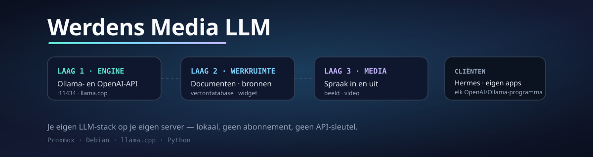

<p align="center">
  
</p>

<p align="center">
  <b>Werdens Media LLM</b> — je eigen LLM-stack op je eigen server.<br>
  Draait volledig lokaal, praat Ollama én OpenAI, en koppelt aan Hermes en je eigen apps.
</p>

<p align="center">
  
  
  
  
  
</p>

---

## Wat het is

Eén stack, drie lagen, alles op je eigen hardware:

| Laag | Wat het doet | Status |
|---|---|---|
| **1. Engine** | Eigen LLM-server met dezelfde API als Ollama plus de OpenAI-API. Beheert modellen, start en stopt de rekenkracht-engine, houdt modellen warm. | **werkt en is getest** |
| **2. Werkruimte** | Werkruimtes per project, documenten erin met bronvermelding, vectordatabase, model-routing, embed-widget voor je eigen sites. | in aanbouw |
| **3. Media** | Spraak naar tekst (Whisper), spraak uit (Piper, Nederlandse stemmen), beeld (ComfyUI/SDXL) en video. | in aanbouw |

Waarom eigen code in plaats van een bestaande app forken: één techniek in plaats
van twee, geen licentie die meereist, en alles wat erin zit is van jou.

## Snel starten (op een Debian-machine)

```bash
# 1) engine ophalen (llama.cpp, voorgebouwde binary — geen compiler nodig)
mkdir -p engine && cd engine
curl -sLO https://github.com/ggml-org/llama.cpp/releases/download/b12262/llama-b12262-bin-ubuntu-x64.tar.gz
tar xzf llama-b12262-bin-ubuntu-x64.tar.gz

# 2) server starten
cd .. && python3 engine/wllm.py serve      # luistert op :11434
```

## Installeren op Proxmox

Op de **Proxmox-host**, als root:

```bash
# de hele stack in één unprivileged LXC (Debian 13, 4 cores, 8 GB, 40 GB schijf)
bash deploy/proxmox/create-werdens-media-llm-lxc.sh
```

Of stap voor stap, in een bestaande container:

```bash
bash deploy/proxmox/provision-werdens-media-llm.sh <CTID>
bash deploy/proxmox/check-werdens-media-llm.sh <CTID>
```

Instellingen gaan via env-variabelen: `CORES`, `MEMORY`, `DISK`, `STATIC_IP`,
`GATEWAY`, `CT_HOSTNAME`, `WMLM_MODEL`, `WMLM_EMBED_MODEL`.

## API

De server praat twee talen op dezelfde poort, zodat bestaande software zonder
aanpassing werkt.

**Ollama-vorm** — `/api/version`, `/api/tags`, `/api/ps`, `/api/show`,
`/api/pull`, `/api/chat`, `/api/generate`, `/api/embed`

**OpenAI-vorm** — `/v1/models`, `/v1/chat/completions`, `/v1/completions`,
`/v1/embeddings`

```bash
# chat, Ollama-vorm met streaming
curl http://192.168.1.100:11434/api/chat -d '{
  "model": "Llama-3.2-3B-Instruct-Q4_K_M",
  "messages": [{"role": "user", "content": "Noem drie Nederlandse provincies."}],
  "stream": true
}'

# chat, OpenAI-vorm
curl http://192.168.1.100:11434/v1/chat/completions -d '{
  "model": "Llama-3.2-3B-Instruct-Q4_K_M",
  "messages": [{"role": "user", "content": "Hallo"}]
}'
```

## CLI

```bash
python3 engine/wllm.py serve        # server starten
python3 engine/wllm.py list         # modellen met grootte, quantisatie en digest
python3 engine/wllm.py ps           # wat er nu geladen is
python3 engine/wllm.py aanbevelen            # welk model past op deze machine?
python3 engine/wllm.py aanbevelen --meten    # dezelfde vraag, met echte cijfers
python3 engine/wllm.py model-info <model>    # architectuur en geheugengebruik
python3 engine/wllm.py pull hf:unsloth/Llama-3.2-3B-Instruct-GGUF/Llama-3.2-3B-Instruct-Q4_K_M.gguf
python3 engine/wllm.py run Llama-3.2-3B-Instruct-Q4_K_M "Wat is een LLM?"
```

## Koppelen

**Hermes Agent** (per sessie, zonder je configuratie te veranderen):

```bash
hermes chat -q "vraag" -m Llama-3.2-3B-Instruct-Q4_K_M \
  --provider custom --base-url http://192.168.1.100:11434/v1 --api-key wmlm-local
```

Twee dingen om te weten voordat je dit doet:
- Hermes eist een contextvenster van **minimaal 64.000 tokens**. Zit je daaronder,
  dan weigert hij met een duidelijke melding — dat is geen storing.
- Op een CPU zonder GPU is dit **traag**: een prompt van 14.000 tokens duurt al
  snel tien minuten. Bruikbaar voor losse vragen en documentvragen, niet als
  agent-brein. Met een GPU (12 GB of meer) verandert dat volledig.

**Je eigen apps**: alles wat OpenAI of Ollama praat, kan tegen deze server. Geen
API-sleutel nodig en er verlaat niets je eigen netwerk.

## Welk model past op jouw machine?

Dit is de knop voor kwaliteit: hoe groter het model, hoe beter het antwoord. Maar
grootte is niet gratis — bij 64k context (wat Hermes eist) kost de KV-cache
alleen al ettelijke gigabytes.

De server meet het zelf, uit de architectuur in de GGUF-kop:

```bash
python3 engine/wllm.py aanbevelen --meten
```

Dat haalt per model ongeveer 1 MB op (de kop, niet het hele bestand) en rekent
uit wat er past. Gemeten voorbeeld op een CPU zonder GPU met 8 GB en 64k context:

| Model | Gewichten | KV-cache | Nodig | Past in 5.825 MB? |
|---|---|---|---|---|
| Qwen3-32B Q4_K_M | 18.846 MB | 8.192 MB | 27.038 MB | nee |
| Qwen3-30B-A3B Q4_K_M | 17.697 MB | 3.072 MB | 20.769 MB | nee |
| Qwen3-14B Q4_K_M | 8.584 MB | 5.120 MB | 13.704 MB | nee |
| Qwen3-8B Q4_K_M | 4.794 MB | 4.608 MB | 9.402 MB | nee |
| Qwen3-4B Q4_K_M | 2.381 MB | 4.608 MB | 6.989 MB | nee |
| **Llama-3.2-3B Q4_K_M** | 1.925 MB | 3.584 MB | 5.509 MB | **ja** |
| Llama-3.2-1B Q4_K_M | 770 MB | 1.024 MB | 1.794 MB | ja |

De uitkomst is niet wat je zou verwachten: de **Llama-3.2-familie** heeft 28
lagen met kop-lengte 128, Qwen3 heeft 36 lagen met dezelfde kop-lengte. Daardoor
is de KV-cache van Llama-3.2 veel kleiner en past Llama-3.2-3B bij 64k waar
Qwen3-4B en 8B niet passen. Op een gewone CPU met 8 GB is Llama-3.2-3B dus het
beste dat je kunt draaien.

Wil je echt kwaliteit (Qwen3-8B of groter), dan is er geen instelling die dat
oplost: er moet geheugen bij, of een GPU. Op een GPU telt alleen het
videogeheugen en is de KV-cache f16, waardoor dezelfde modellen wél passen.

## Configuratie

| Variabele | Default | Betekenis |
|---|---|---|
| `WLLM_HOME` | projectmap | basis voor modellen, logs en manifests |
| `WLLM_MODELS` | `$WLLM_HOME/models` | waar de `.gguf`-bestanden staan |
| `WLLM_ENGINE` | `$WLLM_HOME/engine/llama-b12262/llama-server` | pad naar de engine |
| `WLLM_HOST` / `WLLM_PORT` | `0.0.0.0` / `11434` | luisteradres |
| `WLLM_CTX` | `65536` | contextvenster (Hermes eist minimaal 64.000) |
| `WLLM_KV_TYPE` | `q8_0` | KV-cache-type; 8-bits halveert het geheugen |
| `WLLM_KEEP_ALIVE` | `300` | seconden voordat een ongebruikt model wordt ontladen |
| `WLLM_THREADS` | aantal CPU's | rekenkracht-threads |

## Architectuur

```
Hermes Agent  ·  je eigen apps  ·  embed-widget
        │  Ollama-API (:11434/api/*)   of   OpenAI-API (:11434/v1/*)
        ▼
  engine/wllm.py  (pure Python, alleen stdlib)
        ├── modellen     : gguf-bestanden, manifests, digest, pull en delete
        ├── enginebeheer : één llama-server per model en context, warm houden, ontladen
        └── vertaling    : Ollama- en OpenAI-verzoeken naar de engine
        ▼
  llama-server (llama.cpp)
```

## Status en roadmap

Zie [docs/ROADMAP.md](docs/ROADMAP.md). Kort: de engine werkt en is getest op een
CPU-only machine; de werkruimte- en medialaag volgen.

## Licentie

Alle rechten voorbehouden. Dit is eigen code; gebruik, kopiëren of verspreiden
alleen met toestemming van de maker. Gebruikte onderdelen van derden houden hun
eigen licentie — zie [docs/ROADMAP.md](docs/ROADMAP.md) voor de details.
